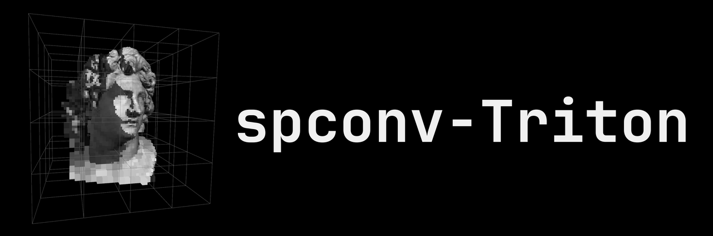

# spconv-Triton

spconv-Triton is a sparse convolution library for PyTorch. It provides submanifold and regular sparse convolution in 1D to 4D. It also provides transposed and inverse convolution, and pooling. The operators are written in [Triton](https://github.com/triton-lang/triton). The same code runs on NVIDIA, AMD, and other accelerators that Triton supports.

spconv-Triton is a drop-in replacement for [spconv 2.x](https://github.com/traveller59/spconv). spconv is the sparse convolution library used in LiDAR 3D object detection and segmentation. Examples are OpenPCDet and mmdetection3d. To switch, change one import. Your models, checkpoints, and training code continue to work.

<div align="center">

✅ Verified with: NVIDIA RTX 3060, A100, H100, L4, B200 &nbsp;•&nbsp; AMD MI300X &nbsp;•&nbsp; `torch 2.4 – 2.15` &nbsp;•&nbsp; `python 3.10 – 3.15`

</div>

## Why spconv-Triton

Sparse convolution is the main operator for 3D perception and generation on point clouds and voxels. [spconv](https://github.com/traveller59/spconv) is fast and widely used. It is no longer maintained. Its prebuilt CUDA kernels run only on NVIDIA hardware. They also support only a narrow range of CUDA, PyTorch, and Python versions.

spconv-Triton implements the same operators in Triton. It supports the full operator set on current PyTorch and Python versions. Its numerical results match spconv.

Use spconv-Triton when spconv does not fit your stack. For example, you may use AMD hardware, or you need a newer PyTorch or Python version. You may also deploy on a system that provides only Triton. spconv-Triton keeps the spconv API. You do not change other parts of your model.

## Installation

Step 1. Install the PyTorch build for your accelerator. This build installs the matching Triton package.

Step 2. Install spconv-Triton.

```bash
pip install spconv-triton
```

> [!NOTE]
> spconv-Triton does not declare Triton as a dependency. PyTorch installs the correct Triton package for your backend. On CUDA, this package is `triton`. On ROCm, it is `pytorch-triton-rocm`. If spconv-Triton declared Triton, pip would install the CUDA package on ROCm systems. This breaks ROCm installs.
> With [uv](https://docs.astral.sh/uv/), set `UV_TORCH_BACKEND=auto`. uv then selects the correct PyTorch build.

## Quickstart

The [API reference](docs/API.md) describes the full API. Read it when you build your model.

If your network comes from spconv, change the import. Keep the rest of your code.

```python
import torch
# import spconv.pytorch as spconv        # before
import spconv_triton.pytorch as spconv   # after

features = torch.randn(1000, 3, device="cuda")
indices = torch.zeros(1000, 4, dtype=torch.int32, device="cuda")   # column 0 is batch
indices[:, 1:] = torch.randint(0, 64, (1000, 3), device="cuda")    # spatial coords, zyx

x = spconv.SparseConvTensor(features, indices, spatial_shape=[64, 64, 64], batch_size=1)

net = spconv.SparseSequential(
    spconv.SubMConv3d(3, 32, 3, padding=1, indice_key="subm0"),
    spconv.SparseConv3d(32, 64, 3, stride=2, padding=1, indice_key="down0"),
    spconv.SparseInverseConv3d(64, 32, 3, indice_key="down0"),
).cuda()

out = net(x)          # SparseConvTensor
dense = out.dense()   # [batch, C, *spatial_shape]
```

`SparseConvTensor` has two main inputs:

- `features`: a tensor of shape `[N, C]`.
- `indices`: an integer tensor of shape `[N, ndim + 1]`. Column 0 is the batch index.

The spatial columns of `indices` and `spatial_shape` must use the same axis order. The convolution and pooling layers work with either `xyz` or `zyx` order.

The voxelization helpers read `xyz` point coordinates and ranges. They return `zyx` indices, as spconv does. A voxelized pipeline therefore runs in `zyx` order.

## Training

### TF32

TF32 is off by default. This matches spconv. TF32 speeds up the fp32 path on supported hardware. Enable it through the top-level package:

```python
import spconv_triton
spconv_triton.constants.SPCONV_ALLOW_TF32 = True
```

Set the constant on `spconv_triton`. Do not set it on the `spconv` alias. The alias points to a module that holds only the version. An assignment there has no effect, and TF32 stays off without an error. On some AMD hardware with torch 2.7 or later, TF32 also requires the environment variable `HIPBLASLT_ALLOW_TF32=1`.

### Mixed precision

Sparse convolution follows the autocast behavior of spconv. This differs from dense `nn.Conv2d`. Under `torch.autocast`, the layers run in fp16 in training mode. They run in fp32 in eval mode. For fp16 inference, call `.half()` on the model.

fp16 GEMMs accumulate in fp32 by default. This gives the same accuracy on all hardware. Set `SPCONV_ALLOW_FP16_ACCUM=1` to accumulate in fp16, as spconv does. This setting is faster only on consumer Ampere and Ada GPUs. Do not use it for large-batch training.

### Compile cache

Triton compiles and autotunes kernels on first use. Set `TRITON_CACHE_DIR` to a stable path. The default is `~/.triton/cache`. The cache keeps compiled kernels. On Triton 3.3.0 and later, it also keeps the autotune results. New processes reuse both.

For distributed training, run a short single-process job first. This fills the cache. Then the ranks do not autotune at the same time.

> [!TIP]
> Use Triton 3.3.0 or later. This avoids recompiling kernels on every run.

### FP fusion

The test suite runs with Triton FP fusion (FMA contraction) enabled. This is the default up to Triton 3.9. Triton 3.10 disables it by default. This changes the kernel numerics slightly. To keep the verified behavior, set `TRITON_DEFAULT_FP_FUSION=1`. On Triton 3.9, this setting also removes the warning `TRITON_DEFAULT_FP_FUSION is unset`.

### torch.compile

The sparse layers run in eager mode. `torch.compile` fuses the dense parts of the model around them.

```python
model = torch.compile(model, fullgraph=False)   # fuses BatchNorm, ReLU, and residual adds on .features
```

Sparse convolution depends on the input data. Point counts, neighborhoods, and sometimes grid sizes change with each input. The kernels already fuse their operations. So `torch.compile` treats them as opaque calls. Use `fullgraph=False`.

## Migrating from spconv

Models, `state_dict` checkpoints, and training code work without changes. You do not need to retrain. Only the import changes. A checkpoint trained with spconv in OpenPCDet or mmdetection3d loads and runs without changes.

Two behaviors match spconv, not PyTorch defaults. See [Training](#training). Autocast keeps eval-mode output in fp32. TF32 stays off until you enable it.

Box operations such as NMS are not ported. Most frameworks provide their own. CPU-only inference and training are not supported. The compute kernels run only on GPUs.

## Performance

The frozen golden data test suite verifies parity with spconv 2.3.8.

On NVIDIA GPUs, relative speed depends on precision. fp16 and TF32 are as fast as spconv or faster. This is most true on server GPUs. fp32 is slower on all tested GPUs.

spconv does not run on AMD. On MI300X, spconv-Triton is faster than FlexGEMM for submanifold convolution. This is the one operator that both libraries provide. spconv-Triton also covers the full operator set.

Each benchmark repeats 10 times. Each run has 200 warmup iterations and 1000 measured iterations. The benchmarks report warm-cache medians. They use a representative width (C256) and 50k voxels. They compare against spconv, FlexGEMM, warpconvnet, and fVDB, where each library is available.

| Hardware | Plots |
|---|---|
| NVIDIA RTX 3060 (Ampere) | [docs/RTX3060](docs/RTX3060/) |
| NVIDIA A100 (Ampere) | [docs/A100](docs/A100/) |
| NVIDIA H100 (Hopper) | [docs/H100](docs/H100/) |
| NVIDIA L4 (Lovelace) | [docs/L4](docs/L4/) |
| AMD MI300X (submanifold) | [docs/MI300X](docs/MI300X/) |

NVIDIA T4 (Turing) runs correctly, but slowly. Use spconv on T4.

## Documentation

| Topic | Location |
|---|---|
| API reference | [docs/API.md](docs/API.md) |
| Environment variables | [docs/ENVIRONMENT_VARIABLES.md](docs/ENVIRONMENT_VARIABLES.md) |
| Changelog | [CHANGELOG.md](CHANGELOG.md) |

## Testing

A GPU is required. The frozen test suite uses committed golden data. It does not need reference spconv.

```bash
uv run pytest tests/ -q -p no:cacheprovider
```

The `tox` matrix covers supported combinations of Python, PyTorch, CUDA, and ROCm. See [tox.ini](tox.ini) for the full list of environments.

## Attribution

spconv-Triton is derived from [spconv](https://github.com/traveller59/spconv) by Yan Yan and contributors. spconv is licensed under the Apache License 2.0. This work is also released under the Apache License 2.0.
